<!-- profilescape:start -->

<picture>
  <source media="(prefers-color-scheme: dark)" srcset="https://raw.githubusercontent.com/Tanish3967/Tanish3967/profilescape-output/hero-dark.svg" />
  
</picture>

<picture>
  <source media="(prefers-color-scheme: dark)" srcset="https://raw.githubusercontent.com/Tanish3967/Tanish3967/profilescape-output/stats-dark.svg" />
  
</picture>

<picture>
  <source media="(prefers-color-scheme: dark)" srcset="https://raw.githubusercontent.com/Tanish3967/Tanish3967/profilescape-output/3d-dark.svg" />
  
</picture>

<picture>
  <source media="(prefers-color-scheme: dark)" srcset="https://raw.githubusercontent.com/Tanish3967/Tanish3967/profilescape-output/languages-dark.svg" />
  
</picture>

<table>
  <tr>
    <td width="50%">
<a href="https://github.com/Tanish3967/Addiction-Breaker">
<picture>
  <source media="(prefers-color-scheme: dark)" srcset="https://raw.githubusercontent.com/Tanish3967/Tanish3967/profilescape-output/repo-tanish3967-addiction-breaker-dark.svg" />
  
</picture>
</a>
    </td>
    <td width="50%">
<a href="https://github.com/Tanish3967/AI-Leave-Agent">
<picture>
  <source media="(prefers-color-scheme: dark)" srcset="https://raw.githubusercontent.com/Tanish3967/Tanish3967/profilescape-output/repo-tanish3967-ai-leave-agent-dark.svg" />
  
</picture>
</a>
    </td>
  </tr>
</table>

<table>
  <tr>
    <td width="50%">
<a href="https://github.com/Tanish3967/etmf">
<picture>
  <source media="(prefers-color-scheme: dark)" srcset="https://raw.githubusercontent.com/Tanish3967/Tanish3967/profilescape-output/repo-tanish3967-etmf-dark.svg" />
  
</picture>
</a>
    </td>
    <td width="50%">
<a href="https://github.com/Tanish3967/Chronos">
<picture>
  <source media="(prefers-color-scheme: dark)" srcset="https://raw.githubusercontent.com/Tanish3967/Tanish3967/profilescape-output/repo-tanish3967-chronos-dark.svg" />
  
</picture>
</a>
    </td>
  </tr>
</table>

<a href="https://github.com/Tanish3967">
<picture>
  <source media="(prefers-color-scheme: dark)" srcset="https://raw.githubusercontent.com/Tanish3967/Tanish3967/profilescape-output/social-github-dark.svg" />
  
</picture>
</a>

<!-- profilescape:end -->
